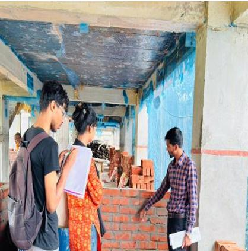
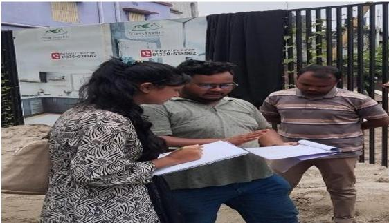
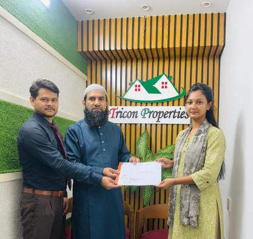
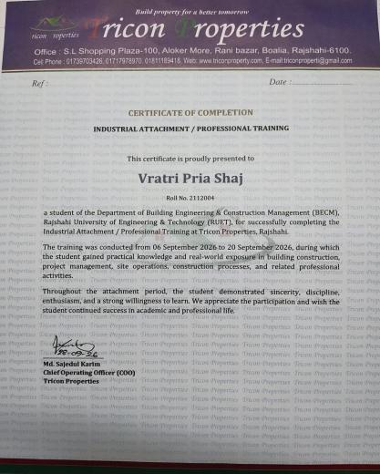

## Industrial Attachment

**Industrial Trainee — Tricon Properties, Rajshahi**  
6–20 September 2026

The industrial attachment provided exposure to construction site activities, site-related communication, project information collection, project management, site operations, and construction processes.

  
  
  
  

## Leadership

- **General Secretary**, GKA Association at RUET — December 2025 – Present
- **Cultural Secretary**, BECM Club, RUET — January 2026 – Present

## Extra-curricular Activities & Achievements

- Architectural Sketching Competition (2019) — **1st Place**
- National-Level Recitation, 10th Inter-School Competition (2018) — **1st Place**
- National-Level Debate, 8th Education Week Competition (2016) — **2nd Place**
