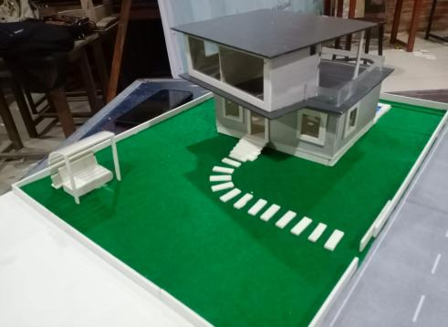
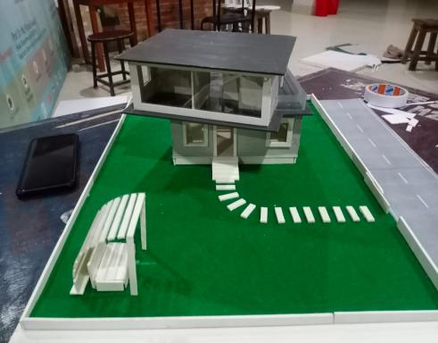
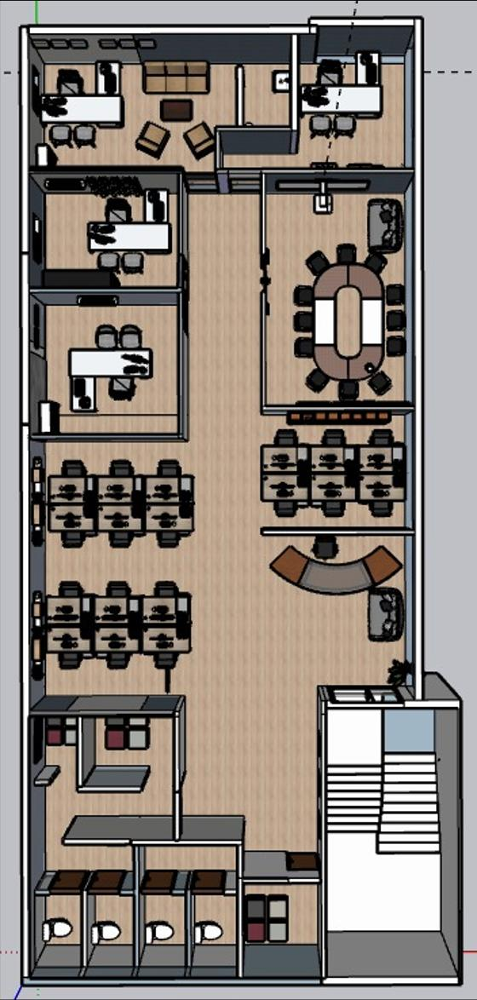
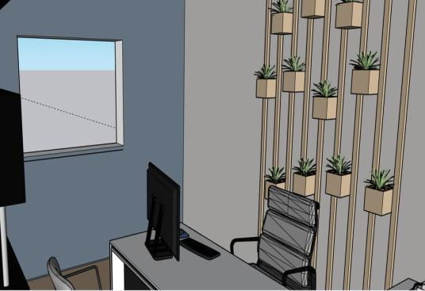

These academic design projects showcase work in building design, interior planning, and landscape design.

## Design of a Vacation House

A physical architectural model illustrating building form, site arrangement, access path, outdoor seating, and the relationship between the house and its landscape. The model includes a curved stepping-stone path, seating, and a small water feature.

  
  
  

## Interior Design of an Office Building

An office layout combining individual work areas, shared workstations, meeting spaces, and a reception zone around a central circulation area.

  
  
  
  

## Proposed Landscaping Design for Tong Area at RUET

A proposed outdoor space arranging seating, a gazebo, greenery and planting, pedestrian walkways, a water feature, and an open lawn. The concept aims to provide RUET students with a comfortable place for relaxation, study, social interaction, and recreation.

  <button class="gallery-lightbox-close" type="button" aria-label="Close enlarged image">&times;</button>
  
  

